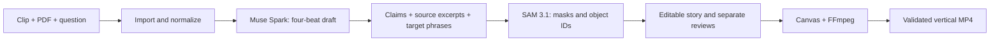

# Oddly Clear Studio

**Turn a question, a clip, and a source PDF into an evidence-linked visual explainer.** Four editable beats, real object masks, and a 20–40 second vertical film.

[Open the studio](https://oddly-clear-studio.vercel.app) · [Watch the 3-minute demo](https://oddly-clear-studio.vercel.app/demo) · [Demo script](submission/DEMO_SCRIPT.md)

Built during the Meta Global AI Developer Hackathon, October 31–November 1, 2026. Theme: **Build for Your World**. Track: **Indie Developer**.

## Why this exists

A technical video needs three things to agree: what the script claims, what the reference actually says, and which moving part the viewer sees. That normally means switching between a document, a script, and a video editor. Oddly Clear Studio connects those decisions in one workspace.

Muse Spark drafts the story from the real video and document pages. SAM 3.1 follows the named part through the footage. The editor keeps claims, citations, timing, object selection, and review state together. A matching quotation is a checkable starting point, not a guarantee that a claim is true.

## Try it

Open the public studio and choose **Open the verified Meta example**. This copies recorded, real Spark/SAM results into your private browser session without making a new model call. Edit a caption, inspect its source, review the highlight, and export. Example reviews come from product QA; they do not mean this visitor personally reviewed the source.

To create a new project, import a clip and a text PDF, then ask a concrete engineering question. The hosted demo accepts 5–30 second clips up to 5 MB and PDFs up to 16 MB / 80 pages. Files are uploaded directly to private storage and isolated by an HttpOnly browser-session cookie. Clearing that cookie removes this browser's access to its saved projects.

Generation and tracking are separate actions that send the chosen media to Meta. Free-credit terms can allow product-improvement use, so use public or non-sensitive materials in the public demo. Live calls use a small, fixed shared credit pool; the recorded example remains useful without another model call. Public demo capacity is limited to three projects per session and twelve total. The local version supports larger inputs.

## Workflow

1. **Import** real video and a readable PDF. The server normalizes footage to 30 fps and extracts page text. Scanned PDFs need OCR first.
2. **Draft with Muse Spark** or write four beats manually. Each beat has a heading, caption, source range, segmentation target, and page-specific excerpt.
3. **Check the source.** The server verifies the excerpt occurs on the cited page. Review whether it supports the actual claim. Changing the claim invalidates its review.
4. **Track with SAM 3.1.** Select the correct object and inspect its masks. If a concept is missed, draw a region and track that source-frame seed. Repeated targets can reuse a completed full-video result. Missing detections remain missing.
5. **Review and render.** All claims and highlights must be reviewed. Changes to timing or object selection invalidate highlight review. The renderer checks dimensions, frame count, and whole-file decoding before offering the download.

Exports are silent H.264 MP4, **1080 × 1920 / 30 fps**, 20–40 seconds. Narration, music, generated cutaways, and channel publishing are outside the editor's current scope. The separate three-minute product demo has synthetic narration.

## Run locally

Requires Node.js 22.13+ and `ffmpeg` / `ffprobe` on PATH.

```sh
npm ci
npm run sample:assets
npm run dev
```

Open http://127.0.0.1:4317. Stop with Ctrl-C; the server stops its own encoders. `npm run build && npm start` runs the production client locally.

The local sample generator downloads the FAA PDF and creates original illustrative footage. Its procedural highlight regions are clearly marked as fixtures, not SAM output. The hosted verified example is a different asset with real Meta responses.

For live local calls, copy `.env.example` to `.env.local`, enter your own `MODEL_API_KEY`, and set `META_API_ENABLED=true` after checking credits and data-use conditions. Settings are re-read per request. Keep this file private; keys stay on the server.

## How it works



The public deployment uses a static client, a Vercel Container Function with FFmpeg, and private Vercel Blob storage. Projects survive instance replacement. Conditional object versions protect concurrent edits; per-project leases prevent overlapping jobs. Streaming task responses keep processing attached to an active request. Interrupted tasks become explicit failures and are never silently replayed.

A persistent reservation ledger bounds shared Meta usage before a request is sent, then settles against numeric provider usage. Uncertain requests retain their reservation. Re-deploying does not reset the ledger. See [deployment notes](DEPLOYMENT.md).

## Validation and limits

```sh
npm test
npm run build
# With a local server and prepared sample assets:
node --import tsx scripts/verify-local.ts
```

Nine tests cover evidence-page mismatch, review invalidation, missing SAM frames, export gates, SSE chunks, long text, source-frame coordinate conversion, and conservative model reservations. The HTTP check uses actual video/PDF upload and checks invalid quotes, stale revisions, manual regions, saved-project restoration, and media delivery; it makes no model calls.

The first live check used one original 28-second helicopter animation and the public FAA Chapter 2 PDF. Spark returned four cited beats. SAM returned main-rotor, tail-rotor, and fuselage masks. A concept-only tail-rotor request returned no match; a box drawn on source frame 210 recovered 840 frames of tracking. The next beat reused those masks. Main-rotor frame 0 had no detection and remains empty. Five provider uploads returned matching deletion confirmations.

The rendered 28-second film contained 840 frames, fully decoded, and its actual browser download matched by SHA-256. Claims were checked against FAA PDF pages 6 and 15, with direction-specific yaw wording edited before export. This is an illustrative test case, not a real-world segmentation benchmark or flight instruction. The hosted release is also checked for session isolation, source/media delivery, persistence, and real browser interactions; private reports stay out of Git.

## New work and inputs

Application code, original helicopter illustration, editing interface, source-review rules, Meta adapters, tracking recovery, renderer, and public hosting were built during this event with Codex assistance. No prior Oddly Clear episodes, production scripts, or earlier contest code/data/keys were copied. Meta runtime inference uses Standard `muse-spark-1.3` and `sam-3.1`; this project does not claim to have used Muse Code or Meta open-weight inference.

The application code is MIT licensed. Third-party dependencies and reference materials retain their own terms. [THIRD_PARTY.md](THIRD_PARTY.md) documents the FAA source and verified example archive. Keep credentials and private preparation under ignored `.env*`, `.secrets/`, and `.local/` paths.

[Participant guide](https://cerebralvalley.ai/e/meta-ai-developer-hackathon/details) · [Official rules](https://cerebralvalley.ai/e/meta-ai-developer-hackathon/waiver)
